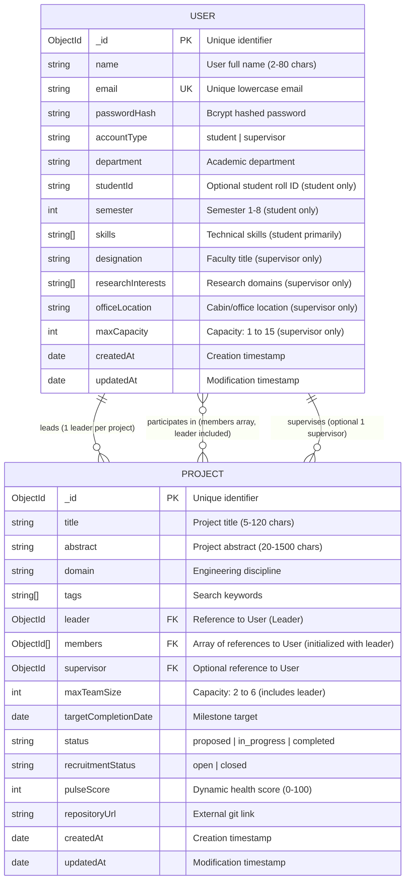

# ProjectForge: MongoDB Data Model Specification

**Document Version:** 1.1.0  
**Target Document:** `docs/DATA_MODEL.md`  
**Related Specification:** `docs/PROJECT_SPEC.md`  
**Status:** Design Specification (Planned Architecture)

---

## 1. Introduction: MongoDB Collections & Mongoose Models

For a student learning the MERN stack, understanding the distinction between MongoDB and Mongoose is fundamental:

* **MongoDB:** A document-oriented NoSQL database that stores data in flexible, JSON-like structures called BSON (Binary JSON) documents. In MongoDB, related documents are grouped into **collections** (analogous to tables in relational databases).
* **Mongoose:** An Object Data Modeling (ODM) library for Node.js. MongoDB itself is schema-less by default, which means it does not enforce structure or types on its own. Mongoose sits between Express.js and MongoDB to provide:
  1. **Schemas:** Explicit blueprints defining which fields are allowed, their data types, and validation rules.
  2. **Models:** JavaScript constructors compiled from schemas that provide high-level methods (e.g., `User.create()`, `Project.findById()`, `Project.find()`) to interact with the database.
  3. **Middleware & Validation:** Built-in hooks to validate incoming data before it ever reaches the database.

In ProjectForge, all project data is persistently stored in MongoDB. Browser storage (such as `localStorage` or `sessionStorage`) must never be used to store authentication JWTs or serve as a primary data store; authentication relies strictly on secure `HttpOnly` session cookies.

---

## 2. Stage 1 Core Collections: Detailed Specifications

Stage 1 focuses on the two foundation collections: **User** and **Project**.

---

### 2.1 The User Collection (`users`)

The `User` collection stores credentials, account types, and academic profile details for both students and faculty supervisors.

#### Field-by-Field Breakdown

| Field Name | Mongoose Type | Required | Default | Account Restriction & Validation Rules | Description |
| :--- | :--- | :--- | :--- | :--- | :--- |
| `name` | `String` | **Yes** | — | Both accounts; trimmed, 2–80 characters | User's full real name. |
| `email` | `String` | **Yes** | — | Both accounts; unique, lowercase, trimmed, valid email format | Primary identifier and login credential. |
| `passwordHash` | `String` | **Yes** | — | Both accounts; 60-character bcrypt hash string | Salted, hashed password. Plaintext is never stored. |
| `accountType` | `String` | **Yes** | — | Enum: `['student', 'supervisor']` | Determines system-level account capabilities. |
| `department` | `String` | **Yes** | — | Both accounts; trimmed string (e.g., 'Computer', 'Electrical') | Academic department or branch. |
| `studentId` | `String` | No | `null` | **Student only**; trimmed string; `null` for supervisors | University roll or registration number. |
| `semester` | `Number` | No | `null` | **Student only**; integer 1 to 8; must be `null` for supervisors | Current semester of undergraduate study. |
| `skills` | `[String]` | No | `[]` | **Student primarily**; array of trimmed strings | Key skills (e.g., "React", "Python", "IoT"). |
| `designation` | `String` | No | `null` | **Supervisor only**; trimmed; must be `null` for students | Academic title (e.g., "Assistant Professor"). |
| `researchInterests` | `[String]` | No | `[]` | **Supervisor only**; array of trimmed strings; empty for students | Research topics (e.g., "Robotics", "Embedded Systems"). |
| `officeLocation` | `String` | No | `null` | **Supervisor only**; trimmed; must be `null` for students | Campus cabin/office for student visits. |
| `maxCapacity` | `Number` | No | `5` (sup.) / `null` (stud.) | **Supervisor only**; integer between 1 and 15; `null` for students | Maximum projects supervisor can advise. |
| `createdAt` | `Date` | Auto | `Date.now` | Managed via Mongoose timestamps | Account creation timestamp. |
| `updatedAt` | `Date` | Auto | `Date.now` | Managed via Mongoose timestamps | Account modification timestamp. |

#### Account-Specific Field Enforcement Rules
To keep data clean and prevent invalid role data:
1. **Student Account Invariants:** When `accountType === 'student'`:
   * `semester` must be an integer between 1 and 8 (if provided).
   * Supervisor-only fields (`designation`, `researchInterests`, `officeLocation`, `maxCapacity`) must remain empty or `null`.
2. **Supervisor Account Invariants:** When `accountType === 'supervisor'`:
   * `semester` and `studentId` must remain `null`.
   * `maxCapacity` must be an **integer between 1 and 15** (default: 5). Floating-point values or values $< 1$ or $> 15$ are rejected.
   * `designation`, `researchInterests`, and `officeLocation` are permitted.

#### Password Security: Why `passwordHash` Instead of Plaintext
Storing plaintext passwords in a database is a major security vulnerability. If the database is compromised, leaked, or inspected during development, user credentials would be exposed immediately.

* In ProjectForge, passwords are never stored directly.
* When a student registers or an account is seeded, the backend takes the plaintext password, generates a random cryptographic salt, and hashes it using the `bcrypt` algorithm (`bcrypt.hash(password, 10)`).
* During login, `bcrypt.compare(candidatePassword, storedPasswordHash)` verifies the credential.
* The field is explicitly named `passwordHash` rather than `password` to remind developers and evaluators that the field holds a one-way mathematical hash, not a reversible or readable password.

#### Email Normalization and Duplicate Key Error Handling
1. **Normalization:** The `email` field is configured with `lowercase: true` and `trim: true` in Mongoose. This ensures that inputs like `"Student@Univ.edu"` and `"student@univ.edu "` are saved identically, preventing duplicate accounts caused by casing or whitespace.
2. **Unique Index:** A MongoDB unique index (`{ unique: true }`) is placed on `email`. MongoDB will reject any insertion attempt if an identical email already exists.
3. **Handling Error Code 11000:** When MongoDB encounters a duplicate unique key violation, it throws an error with `code: 11000`. The Express backend error handling middleware intercepts this code and converts it to a clean, user-friendly HTTP 409 Conflict response:
   ```javascript
   // Error handling middleware snippet
   if (err.code === 11000 && err.keyPattern && err.keyPattern.email) {
     return res.status(409).json({
       success: false,
       message: 'An account with this email address already exists.',
       data: null,
       errors: [{ field: 'email', message: 'Email address is already in use.' }]
     });
   }
   ```

#### Mongoose Schema Definition: `User.js`
```javascript
const mongoose = require('mongoose');

const userSchema = new mongoose.Schema(
  {
    name: {
      type: String,
      required: [true, 'Name is required'],
      trim: true,
      minlength: [2, 'Name must be at least 2 characters'],
      maxlength: [80, 'Name cannot exceed 80 characters']
    },
    email: {
      type: String,
      required: [true, 'Email is required'],
      unique: true,
      lowercase: true,
      trim: true,
      match: [/^\S+@\S+\.\S+$/, 'Please provide a valid email address']
    },
    passwordHash: {
      type: String,
      required: [true, 'Password hash is required']
    },
    accountType: {
      type: String,
      required: [true, 'Account type is required'],
      enum: {
        values: ['student', 'supervisor'],
        message: 'Account type must be either student or supervisor'
      }
    },
    department: {
      type: String,
      required: [true, 'Department is required'],
      trim: true
    },
    // Student-only optional fields
    studentId: {
      type: String,
      trim: true,
      default: null,
      validate: {
        validator: function(val) {
          if (!val) return true;
          return this.accountType === 'student';
        },
        message: 'Student ID can only be set for student accounts'
      }
    },
    semester: {
      type: Number,
      default: null,
      validate: {
        validator: function(val) {
          if (val === null || val === undefined) return true;
          return this.accountType === 'student' && Number.isInteger(val) && val >= 1 && val <= 8;
        },
        message: 'Semester is student-only and must be an integer between 1 and 8'
      }
    },
    skills: {
      type: [String],
      default: []
    },
    // Supervisor-only optional fields
    designation: {
      type: String,
      trim: true,
      default: null,
      validate: {
        validator: function(val) {
          if (!val) return true;
          return this.accountType === 'supervisor';
        },
        message: 'Designation can only be specified for supervisor accounts'
      }
    },
    researchInterests: {
      type: [String],
      default: [],
      validate: {
        validator: function(val) {
          if (!val || val.length === 0) return true;
          return this.accountType === 'supervisor';
        },
        message: 'Research interests can only be specified for supervisor accounts'
      }
    },
    officeLocation: {
      type: String,
      trim: true,
      default: null,
      validate: {
        validator: function(val) {
          if (!val) return true;
          return this.accountType === 'supervisor';
        },
        message: 'Office location can only be specified for supervisor accounts'
      }
    },
    maxCapacity: {
      type: Number,
      default: function() {
        return this.accountType === 'supervisor' ? 5 : null;
      },
      validate: {
        validator: function(val) {
          if (val === null || val === undefined) return this.accountType === 'student';
          return (
            this.accountType === 'supervisor' &&
            Number.isInteger(val) &&
            val >= 1 &&
            val <= 15
          );
        },
        message: 'maxCapacity is supervisor-only and must be an integer between 1 and 15'
      }
    }
  },
  {
    timestamps: true // Automatically manages createdAt and updatedAt
  }
);

module.exports = mongoose.model('User', userSchema);
```

---

### 2.2 The Project Collection (`projects`)

The `Project` collection stores the core information for each academic engineering project workspace.

#### Field-by-Field Breakdown

| Field Name | Mongoose Type | Required | Default | Validation & Constraints | Description |
| :--- | :--- | :--- | :--- | :--- | :--- |
| `title` | `String` | **Yes** | — | Trimmed, 5–120 characters | The formal name of the project. |
| `abstract` | `String` | **Yes** | — | Trimmed, 20–1500 characters | Problem summary, proposed solution, and scope. Matches `docs/PROJECT_SPEC.md`. |
| `domain` | `String` | **Yes** | — | Enum: `['Computer', 'Electrical', 'Mechanical', 'Civil', 'Biomedical', 'Multidisciplinary']` | Engineering discipline/branch. |
| `tags` | `[String]` | No | `[]` | Array of trimmed strings (e.g., `["IoT", "Node.js"]`) | Searchable keyword tags. |
| `leader` | `ObjectId` | **Yes** | — | Reference to `User` model (`ref: 'User'`) | The student who created and administers the project. |
| `members` | `[ObjectId]` | **Yes** | `[leader]` | Array of references to `User` model (`ref: 'User'`) | Initialized with the leader's ID. **The leader counts toward `maxTeamSize`**. |
| `supervisor` | `ObjectId` | No | `null` | Reference to `User` model (`ref: 'User'`) | Faculty supervisor assigned to the project. |
| `maxTeamSize` | `Number` | **Yes** | `4` | Min: 2, Max: 6 | Maximum allowable team members **including the leader**. |
| `targetCompletionDate` | `Date` | **Yes** | — | Must be a valid date in the future | Semester milestone deadline. |
| `status` | `String` | **Yes** | `'proposed'` | Enum: `['proposed', 'in_progress', 'completed']` | Project lifecycle status. |
| `recruitmentStatus` | `String` | **Yes** | `'open'` | Enum: `['open', 'closed']` | Whether the project accepts student join requests. |
| `pulseScore` | `Number` | **Yes** | `0` | Integer, 0 to 100 | Calculated project health metric (fully specified below). |
| `repositoryUrl` | `String` | No | `''` | Validated web URL (`http://` or `https://`) | External source code repository (e.g., GitHub). |
| `createdAt` | `Date` | Auto | `Date.now` | Managed via Mongoose timestamps | Project creation date. |
| `updatedAt` | `Date` | Auto | `Date.now` | Managed via Mongoose timestamps | Project update date. |

---

#### Initial Team Membership & Team Capacity Rules
* **Leader Initialization:** When a student creates a project via `POST /api/projects`, the backend sets `leader = req.user._id` and initializes the `members` array containing that same ID:
  ```javascript
  members = [req.user._id];
  ```
* **Leader Counts Toward `maxTeamSize`:** The leader is an active team member and occupies the first slot.
  * For example, if `maxTeamSize: 4`, the team consists of 1 leader + up to 3 joined student members.
  * `Available Member Slots = maxTeamSize - members.length`.
* **Automatic Recruitment Closure:** When incoming membership requests are approved and `members.length === maxTeamSize`, the project automatically transitions `recruitmentStatus` to `'closed'`.

---

#### Protected Fields on General Project Updates (`PATCH /api/projects/:id`)
To maintain strict system integrity, the general project update endpoint (`PATCH /api/projects/:id`) can only modify non-structural metadata. Four fields are **strictly protected** and must never be altered through general project updates:

1. **`leader`:** Fixed at creation. Cannot be reassigned or transferred via project edit.
2. **`members`:** Cannot be directly edited via project updates. Members can only be added via the approved join request endpoint (`PATCH /api/membership-requests/:id/approve`) or removed via member deletion (`DELETE /api/projects/:id/members/:userId`).
3. **`supervisor`:** Cannot be set or removed via project updates. Assigned exclusively through the formal supervision workflow (`PATCH /api/supervision-requests/:id/accept`).
4. **`pulseScore`:** A system-calculated metric. Clients cannot manually edit this score. It is recomputed deterministically from task data.

> **Backend Enforcement:** The `updateProject` controller must explicitly whitelist permitted fields: `title`, `abstract`, `domain`, `tags`, `maxTeamSize` (which cannot be set lower than the current `members.length`), `targetCompletionDate`, `status`, and `repositoryUrl`. Any attempt to pass `leader`, `members`, `supervisor`, or `pulseScore` in the update payload is ignored or rejected.

---

#### Complete Project Pulse Specification (Matching `PROJECT_SPEC.md`)
The `pulseScore` ($0$ to $100$) represents project health calculated objectively from actual task data.

$$\text{Task Completion Rate} = \frac{\text{Completed Tasks}}{\text{Total Tasks}} \times 100$$

$$\text{Overdue Incomplete Tasks} = \text{Count of tasks where } (\text{status} \neq \text{'done'} \text{ and } \text{dueDate} < \text{Now})$$

$$\text{Overdue Penalty} = \text{Overdue Incomplete Tasks} \times 10$$

$$\text{Project Pulse} = \max\left(0, \min\left(100, \operatorname{round}(\text{Task Completion Rate} - \text{Overdue Penalty})\right)\right)$$

##### Precise Edge Cases & Status Bands:
1. **Zero Tasks Case:**
   * When `totalTasks === 0`, `pulseScore = 0`.
   * **Badge Color:** Gray.
   * **Status Label:** `"No Tasks Yet"`.
   * **User Feedback:** *"No tasks created yet. Click 'Add Task' to assign items and track Project Pulse."*
2. **All Tasks Completed:**
   * When all tasks have `status: 'done'`, $\text{Overdue Penalty} = 0$, so `pulseScore = 100` (`"On Track"`).
3. **Overdue Penalty Bounds:**
   * The formula enforces a lower bound at $0$ and upper bound at $100$. The score never becomes negative.
4. **Zero Score with Tasks Present:**
   * When `totalTasks > 0` but the calculated score is $0\%$ (due to 0 completed tasks or overdue penalties offsetting completion rate), `pulseScore = 0`.
   * **Badge Color:** Red.
   * **Status Label:** `"At Risk"`.
   * **User Feedback:** *"Project has active tasks with 0% progress or overdue penalties. Review incomplete tasks."*

| Pulse Score Range | Badge Color | Status Label | Meaning |
| :--- | :--- | :--- | :--- |
| **0% (with 0 tasks)** | Gray | `No Tasks Yet` | Team needs to add tasks. |
| **0% (with tasks) – 39%** | Red | `At Risk` | Zero or very low completion rate, or high overdue count with active tasks. |
| **40% – 74%** | Amber / Yellow | `In Progress` | Moderate progress, some pending tasks. |
| **75% – 100%** | Green | `On Track` | High completion rate, deadlines on schedule. |

---

#### Representation of Leader and Members (MongoDB ObjectIds & Population)
In MongoDB, we use document references rather than SQL join tables:
1. **Leader (`leader`):** Stored as a single `mongoose.Schema.Types.ObjectId` referencing the `User` collection.
2. **Members (`members`):** Stored as an array of `ObjectId`s (`[{ type: mongoose.Schema.Types.ObjectId, ref: 'User' }]`).
3. **Mongoose Population (`.populate()`) & Privacy Separation:** Mongoose dereferences these IDs into readable user profile objects. To protect student privacy, public endpoints and private workspace views use separate population projections:
   ```javascript
   // In projectController.js
   // 1. Public Project Projection (Unauthenticated visitors & non-members)
   // Private contact info (email, studentId) is strictly omitted
   const publicProject = await Project.findById(projectId)
     .populate('leader', 'name department')
     .populate('members', 'name department skills')
     .populate('supervisor', 'name department designation');

   // 2. Private Workspace Projection (Authorized Leader, Members, and Assigned Supervisor)
   // Discloses full operational contact details to authorized collaborators
   const privateProject = await Project.findById(projectId)
     .populate('leader', 'name email department studentId')
     .populate('members', 'name email department skills studentId')
     .populate('supervisor', 'name email department designation researchInterests officeLocation');
   ```

#### Mongoose Schema Definition: `Project.js`
```javascript
const mongoose = require('mongoose');

const projectSchema = new mongoose.Schema(
  {
    title: {
      type: String,
      required: [true, 'Project title is required'],
      trim: true,
      minlength: [5, 'Project title must be at least 5 characters'],
      maxlength: [120, 'Project title cannot exceed 120 characters']
    },
    abstract: {
      type: String,
      required: [true, 'Project abstract is required'],
      trim: true,
      minlength: [20, 'Abstract must be at least 20 characters'],
      maxlength: [1500, 'Abstract cannot exceed 1500 characters']
    },
    domain: {
      type: String,
      required: [true, 'Engineering domain is required'],
      enum: {
        values: [
          'Computer',
          'Electrical',
          'Mechanical',
          'Civil',
          'Biomedical',
          'Multidisciplinary'
        ],
        message: 'Invalid engineering domain'
      }
    },
    tags: {
      type: [String],
      default: []
    },
    leader: {
      type: mongoose.Schema.Types.ObjectId,
      ref: 'User',
      required: [true, 'Project leader is required']
    },
    members: [
      {
        type: mongoose.Schema.Types.ObjectId,
        ref: 'User'
      }
    ],
    supervisor: {
      type: mongoose.Schema.Types.ObjectId,
      ref: 'User',
      default: null
    },
    maxTeamSize: {
      type: Number,
      required: [true, 'Maximum team size is required'],
      min: [2, 'Team size must be at least 2 (leader + 1 member)'],
      max: [6, 'Team size cannot exceed 6 for undergraduate projects'],
      default: 4
    },
    targetCompletionDate: {
      type: Date,
      required: [true, 'Target completion date is required']
    },
    status: {
      type: String,
      enum: {
        values: ['proposed', 'in_progress', 'completed'],
        message: 'Status must be proposed, in_progress, or completed'
      },
      default: 'proposed'
    },
    recruitmentStatus: {
      type: String,
      enum: {
        values: ['open', 'closed'],
        message: 'Recruitment status must be open or closed'
      },
      default: 'open'
    },
    pulseScore: {
      type: Number,
      default: 0,
      min: 0,
      max: 100
    },
    repositoryUrl: {
      type: String,
      trim: true,
      default: ''
    }
  },
  {
    timestamps: true
  }
);

// Indexing for search performance
projectSchema.index({ title: 'text', abstract: 'text', tags: 'text' });
projectSchema.index({ domain: 1, status: 1, recruitmentStatus: 1 });

module.exports = mongoose.model('Project', projectSchema);
```

---

## 3. Stage 1 Entity Relationship Diagram (ERD)

The diagram below visualizes the relationship between the `User` and `Project` collections in Stage 1:



---

## 4. Deletion Strategy & Referential Integrity (Stage 1 & Beyond)

In relational databases (SQL), foreign keys often use automatic `ON DELETE CASCADE` constraints. MongoDB does not have built-in foreign key cascades.

### 4.1 Stage 1 Deletion Approach (Simple & Direct)
In Stage 1, only the `User` and `Project` collections exist:
* **Project Deletion:** When a project leader deletes their project, the backend simply deletes the single document:
  ```javascript
  await Project.findByIdAndDelete(projectId);
  ```
* **No Cascading Complications in Stage 1:** Because no sub-collections (tasks, comments, join requests) exist yet in Stage 1, there are no orphaned child records to worry about.
* **User Accounts:** Deleting a user account is not permitted in Stage 1, eliminating the risk of a project pointing to a nonexistent leader.

### 4.2 Planned Cleanup for Later Stages (Stage 2 & Stage 3)
When sub-collections are introduced in later stages, they will reference `project: projectId`.

#### Correct Order of Deletion: Child Collections Before Parent
To prevent permanently orphaned records, **child collections must be deleted before the project document itself**:
1. If the project document were deleted first and an unexpected error occurred during child deletion (e.g., database timeout or process termination), the parent project would be gone while child records remained orphaned with no way to identify their parent.
2. By deleting child collections first, if child deletion fails, the project document still exists, allowing the operation to be safely retried.

#### Handling Potential Partial Failures in Multi-Collection Cleanup
In a student project without replica set multi-document transactions, running multiple `deleteMany()` operations can partially fail if an error occurs midway through the batch. The controller must handle this safely:

```javascript
// Planned Stage 2/3 cleanup pattern in projectController.js
exports.deleteProject = async (req, res, next) => {
  const { id } = req.params;

  try {
    // 1. Verify project exists and caller is leader
    const project = await Project.findById(id);
    if (!project) {
      return res.status(404).json({
        success: false,
        message: 'Project not found',
        data: null,
        errors: [{ message: 'Project not found' }]
      });
    }
    if (!project.leader.equals(req.user._id)) {
      return res.status(403).json({
        success: false,
        message: 'Only the project leader can delete this project',
        data: null,
        errors: [{ message: 'Forbidden: Insufficient privileges' }]
      });
    }

    // 2. Delete child collections FIRST
    // Any error here leaves the project intact so the leader can retry
    await Promise.all([
      Task.deleteMany({ project: id }),
      MembershipRequest.deleteMany({ project: id }),
      SupervisionRequest.deleteMany({ project: id }),
      DocumentLink.deleteMany({ project: id }),
      DiscussionComment.deleteMany({ project: id }),
      Submission.deleteMany({ project: id })
    ]);

    // 3. Delete the parent project document ONLY AFTER child cleanup succeeds
    await Project.findByIdAndDelete(id);

    return res.status(200).json({
      success: true,
      message: 'Project and all associated resources deleted successfully',
      data: null,
      errors: null
    });
  } catch (err) {
    // If child deletion partially fails, the project still exists.
    // The client receives an error and can safely retry deletion.
    console.error(`Deletion error for project ${id}:`, err);
    return res.status(500).json({
      success: false,
      message: 'An error occurred during project cleanup. Please try again.',
      data: null,
      errors: [{ message: err.message }]
    });
  }
};
```

---

## 5. Future Stage Collections (Planned Architecture)

> **Note on Implementation Status:** The collections described below are **planned designs** for Stage 2 and Stage 3. They are **not implemented in Stage 1**. They are documented here to guarantee that our Stage 1 foundation (especially the `User` and `Project` schemas) seamlessly supports them.

---

### 5.1 Planned Stage 2 Collections

#### 1. `MembershipRequest` Collection (`membershiprequests`)
* **Purpose:** Handles the student application workflow to join an existing project.
* **Key Fields:**
  * `project`: `ObjectId` referencing `Project` (required).
  * `student`: `ObjectId` referencing `User` (required).
  * `statement`: `String` (required, max 300 characters, student's motivation/skills).
  * `status`: `String`, enum: `['pending', 'approved', 'rejected', 'cancelled']`, default: `'pending'`.
  * `createdAt`: `Date`, default: `Date.now`.

#### 2. `Task` Collection (`tasks`)
* **Purpose:** Stores individual action items, deadlines, and assigned team members.
* **Key Fields:**
  * `project`: `ObjectId` referencing `Project` (required).
  * `title`: `String` (required, max 100 characters).
  * `description`: `String` (optional, max 500 characters).
  * `assignedTo`: `ObjectId` referencing `User` (optional, must be a project member).
  * `createdBy`: `ObjectId` referencing `User` (required, set to the authenticated user who created the task; used to authorize task deletion by creator or project leader).
  * `dueDate`: `Date` (required).
  * `priority`: `String`, enum: `['low', 'medium', 'high']`, default: `'medium'`.
  * `status`: `String`, enum: `['todo', 'in_progress', 'done']`, default: `'todo'`.
  * `completedAt`: `Date` (default: `null`, stamped when status becomes `'done'`).
  * `createdAt`: `Date`, default: `Date.now`.
* **Authorization Note:** Deleting a task requires that the requester be either the task creator (`createdBy`) or the Project Leader.
* **Relationship to Project Pulse:** Querying tasks where `project = projectId` provides the counts for completed tasks, total tasks, and overdue incomplete tasks used to compute `project.pulseScore` using the exact formula specified in Section 2.2.

---

### 5.2 Planned Stage 3 Collections

#### 3. `SupervisionRequest` Collection (`supervisionrequests`)
* **Purpose:** Manages formal mentorship proposals sent by project leaders to faculty supervisors.
* **Key Fields:**
  * `project`: `ObjectId` referencing `Project` (required).
  * `supervisor`: `ObjectId` referencing `User` (required, must have `accountType: 'supervisor'`).
  * `proposalMessage`: `String` (required, max 1000 characters).
  * `status`: `String`, enum: `['pending', 'accepted', 'declined']`, default: `'pending'`.
  * `feedback`: `String` (optional supervisor note, max 500 characters).
  * `createdAt`: `Date`, default: `Date.now`.
  * `reviewedAt`: `Date` (default: `null`).

#### 4. `DocumentLink` Collection (`documentlinks`)
* **Purpose:** Stores validated external resource links (Google Drive, GitHub, Overleaf, Figma) rather than binary file uploads.
* **Key Fields:**
  * `project`: `ObjectId` referencing `Project` (required).
  * `title`: `String` (required, max 100 characters).
  * `url`: `String` (required, validated HTTP/HTTPS format).
  * `category`: `String`, enum: `['specification', 'code_repository', 'design_diagram', 'report', 'presentation', 'other']`.
  * `description`: `String` (optional, max 300 characters).
  * `addedBy`: `ObjectId` referencing `User` (required).
  * `createdAt`: `Date`, default: `Date.now`.

#### 5. `DiscussionComment` Collection (`discussioncomments`)
* **Purpose:** Threaded communication feed within the project workspace.
* **Key Fields:**
  * `project`: `ObjectId` referencing `Project` (required).
  * `author`: `ObjectId` referencing `User` (required).
  * `content`: `String` (required, max 2000 characters).
  * `isPinned`: `Boolean` (default: `false`, can be toggled by Leader or Supervisor).
  * `createdAt`: `Date`, default: `Date.now`.

#### 6. `Submission` Collection (`submissions`)
* **Purpose:** Formal milestone deliverable submissions reviewed by the assigned supervisor.
* **Key Fields:**
  * `project`: `ObjectId` referencing `Project` (required).
  * `title`: `String` (required, e.g., *"Interim Progress Report"*).
  * `deliverableUrl`: `String` (required, validated external link).
  * `notes`: `String` (optional team notes, max 800 characters).
  * `submittedBy`: `ObjectId` referencing `User` (required, project leader).
  * `status`: `String`, enum: `['submitted', 'approved', 'revisions_requested']`, default: `'submitted'`.
  * `supervisorFeedback`: `String` (optional feedback guidance, max 1500 characters).
  * `reviewedAt`: `Date` (default: `null`).
  * `createdAt`: `Date`, default: `Date.now`.

---

## 6. Consistency Verification Checklist

| Specification Item | `docs/PROJECT_SPEC.md` | `docs/DATA_MODEL.md` | Status |
| :--- | :--- | :--- | :--- |
| **User Account Types** | `'student'`, `'supervisor'` | `'student'`, `'supervisor'` | **Consistent** |
| **User Role Restrictions** | `semester` student-only; `designation`, `researchInterests`, `officeLocation`, `maxCapacity` supervisor-only | Enforced via conditional validators; `maxCapacity` 1–15 | **Consistent** |
| **Authentication & Cookie Transport** | JWT in `token` `HttpOnly` cookie (SameSite=Strict, secure in prod); no `localStorage`/`sessionStorage` | Stored in MongoDB; no JWT in `localStorage`/`sessionStorage`; secure cookie sessions | **Consistent** |
| **Project Statuses** | `'proposed'`, `'in_progress'`, `'completed'` | `'proposed'`, `'in_progress'`, `'completed'` | **Consistent** |
| **Project Recruitment** | `'open'`, `'closed'` | `'open'`, `'closed'` | **Consistent** |
| **Description Field** | Named `abstract` | Named `abstract` | **Consistent** |
| **Leader & Team Capacity** | Leader in `members`, counts toward `maxTeamSize` | Leader in `members`, counts toward `maxTeamSize` | **Consistent** |
| **Project Update Method & Protected Fields** | `PATCH /api/projects/:id`; `leader`, `members`, `supervisor`, `pulseScore` protected | Strictly protected from `PATCH /api/projects/:id` | **Consistent** |
| **Project-Detail Privacy** | Public view omits email/studentId; private workspace view restricted to members, leader, supervisor | Separate public and private population projections | **Consistent** |
| **Project Pulse Formula & Zero Cases** | $\max(0, \min(100, \text{Rate} - \text{Penalty}))$; 0 tasks = Gray `No Tasks Yet`; 0% with tasks = Red `At Risk` | Identical formula, penalty, and edge cases | **Consistent** |
| **Membership Request Statuses**| `'pending'`, `'approved'`, `'rejected'`, `'cancelled'` | `'pending'`, `'approved'`, `'rejected'`, `'cancelled'` | **Consistent** |
| **Task Schema & Creator Reference** | `createdBy` required reference to `User`; deletion by creator or leader | `createdBy` required reference to `User`; deletion by creator or leader | **Consistent** |
| **Task Statuses** | `'todo'`, `'in_progress'`, `'done'` | `'todo'`, `'in_progress'`, `'done'` | **Consistent** |
| **Supervision Request Statuses**| `'pending'`, `'accepted'`, `'declined'` | `'pending'`, `'accepted'`, `'declined'` | **Consistent** |
| **Document Link Editing** | Added `PATCH /api/documents/:documentId` for contributor or leader | Documented for contributor or leader authorization | **Consistent** |
| **Submission Statuses** | `'submitted'`, `'approved'`, `'revisions_requested'` | `'submitted'`, `'approved'`, `'revisions_requested'` | **Consistent** |
| **Milestone Entity Architecture** | Consolidated into `Task` deadlines & `Submission` deliverables (no separate collection) | Consolidated into `Task` deadlines & `Submission` deliverables (no separate collection) | **Consistent** |
| **Deletion Cleanup Strategy** | Child collections deleted before parent Project document | Child collections deleted before parent Project document | **Consistent** |
| **Storage Strategy** | MongoDB persistence only, no binary file uploads | MongoDB collections, validated URL fields | **Consistent** |
